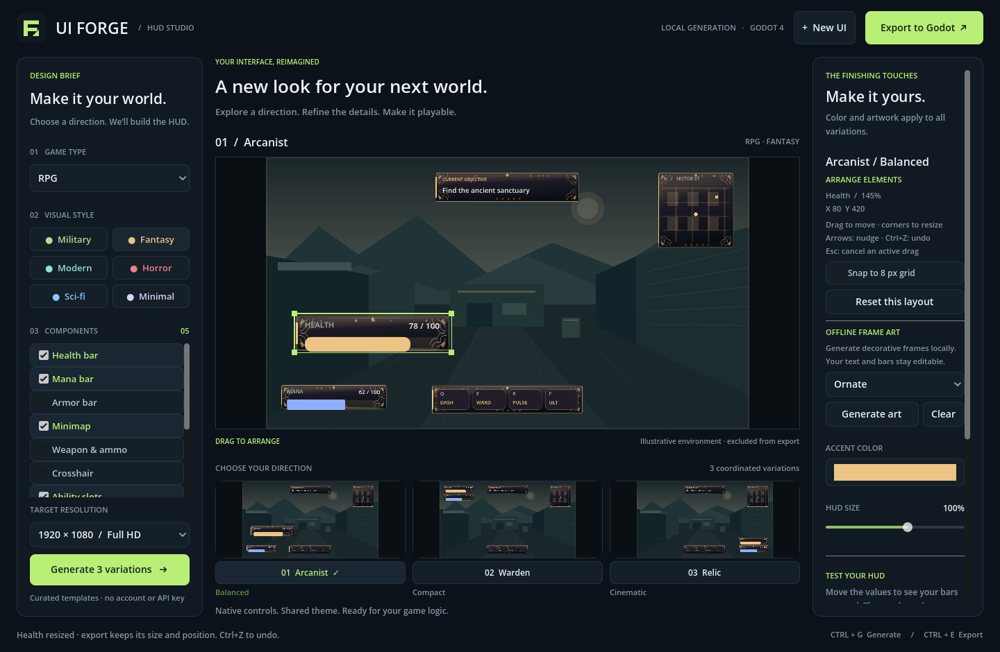

# UI Forge

Create health bars, mana bars, minimaps, weapon displays, and other HUD elements
for your Godot game. Choose a game type and visual style, preview three layouts,
then export an editable Godot scene and theme.

## Start here

| What you want to do | Follow this guide |
| --- | --- |
| Run the desktop app on Windows | [Windows: download, extract, launch, and create your first HUD](docs/windows-guide.md) |
| Run UI Forge using the Godot editor | [Godot: open the source project and press Play](docs/godot-guide.md#run-ui-forge-from-source) |
| Add a generated HUD to your own game | [Godot: import the HUD and connect health to gameplay](docs/godot-guide.md#add-an-exported-hud-to-your-game) |
| Test the code or build a Windows ZIP yourself | [Development and packaging](docs/development.md) |

## Run on Windows

1. Open [GitHub Releases](https://github.com/Ruslanf89/UI_Generator/releases).
2. Under a release's **Assets**, download `UIForge-windows-x86_64.zip` when available.
3. In Windows File Explorer, right-click the ZIP and choose **Extract All…**.
4. Open the extracted folder, then its `UIForge` folder.
5. Double-click **UIForge.exe**. Keep `UIForge.pck` beside the executable.

The packaged app includes its runtime. You do not need to install Godot, Python,
or Git to run it. It runs locally without an account or API key.

**If there is no Windows ZIP under Assets**, follow the
[Godot source-project instructions](docs/godot-guide.md#run-ui-forge-from-source).
GitHub's **Source code (zip)** and **Code → Download ZIP** downloads contain the
project rather than a ready-to-run Windows executable.

## Create and export your first HUD

1. Click **New UI**. Choose a game type, such as **FPS**.
2. Choose a visual style, such as **Military**.
3. Tick the components you want. Scroll the component list to see all options.
4. Choose a target resolution and click **Generate 3 variations**.
5. Click a variation's thumbnail or name. Change the accent color and HUD size
   on the right. Health and mana sliders preview the selected bars.
6. Drag components in the large preview to arrange them, then drag a selected
   component's corner handles to rescale it. Optional snapping, keyboard
   nudging, undo/redo, and **Reset this layout** help refine placement.
7. In **Offline Frame Art** on the right, choose a detail style and click
   **Generate art** for decorative panel artwork. Scroll the right panel if needed.
8. Click **Export to Godot** and select an existing folder to save into.

The app creates a new folder containing `hud.tscn`, `hud_theme.tres`,
`preset.json`, and a `README.md` integration guide. Copy the **whole folder** into
your game's Godot project, then follow the
[step-by-step Godot import guide](docs/godot-guide.md#add-an-exported-hud-to-your-game).
When artwork is enabled, the folder also includes generated PNGs under `art/`.
The exported scene keeps your custom element positions and individual scales.

## What this version provides

- Six game types: FPS, RPG, RTS, Racing, Survival, and Platformer.
- Six styles: Military, Fantasy, Modern, Horror, Sci-fi, and Minimal.
- Twelve optional HUD components and three coordinated layout variations.
- Mouse placement and proportional corner resizing per variation, optional
  8 px snapping, arrow-key nudging,
  undo/redo, and preset layout reset.
- Offline, seeded frame artwork with style-native, ornate, tech, and weathered details.
- Editable native Godot controls and a shared theme, with no generator plugin
  required in your game.

Generation uses local templates. The map, ammo, timers, and ability slots use
example data; connect them to your game logic. The preview background is not
included in the exported HUD. Artwork is generated procedurally on your PC;
it does not use an AI image service or require a key.

Designs are held in memory. **Export before closing the app or clicking New UI.**
Changing the brief requires Generate to apply; Generate resets the current
color, size, sample values, component positions/scales, and generated artwork.
Existing exports are kept in separate folders. Loading exported presets back
into the designer is not implemented.

The app and exports target **Godot 4.6+**, tested with **4.6.3**. The packaged
desktop targets Windows x64 with OpenGL 3.3-compatible graphics and needs space
for a **1120 × 900** window. Packaging and application checks ran on Linux;
native Windows execution remains untested.
