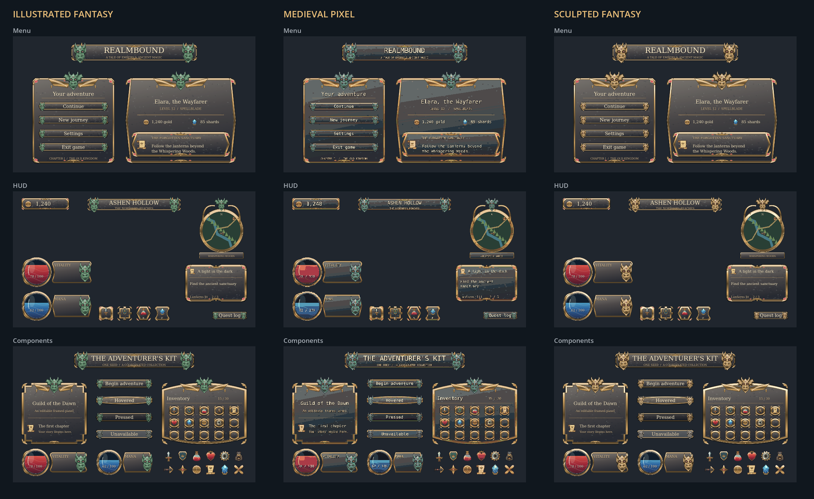
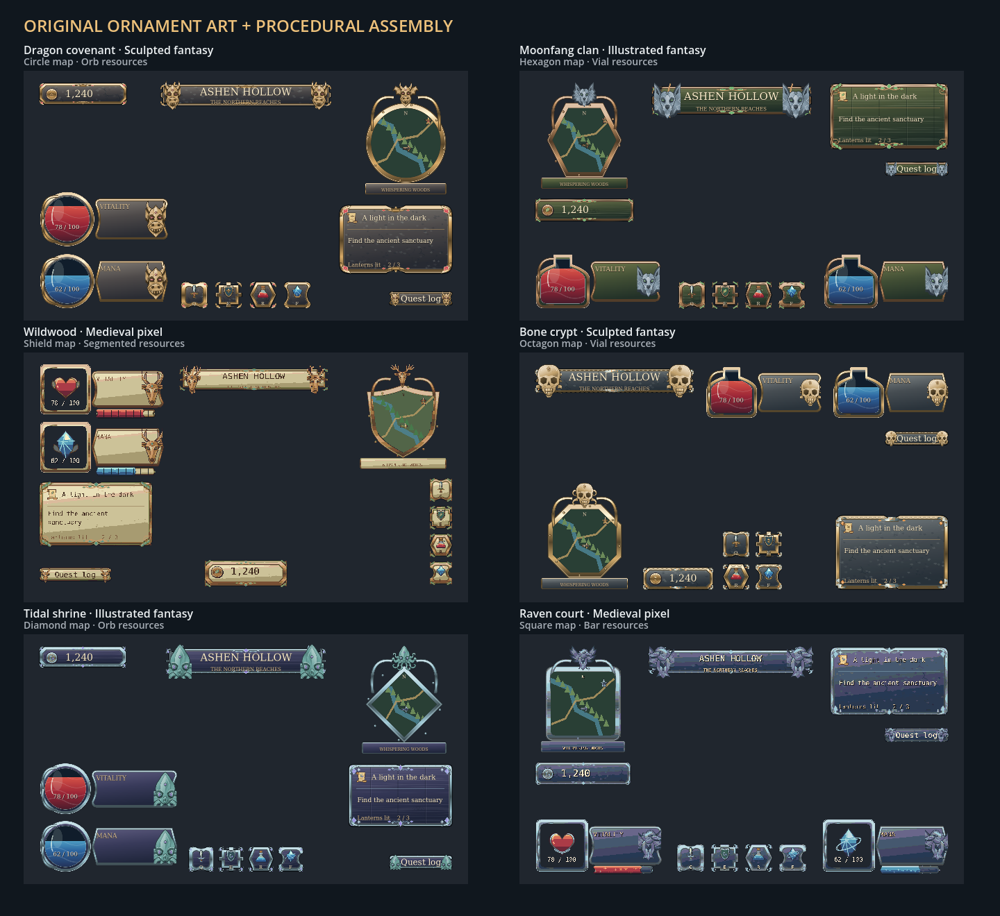
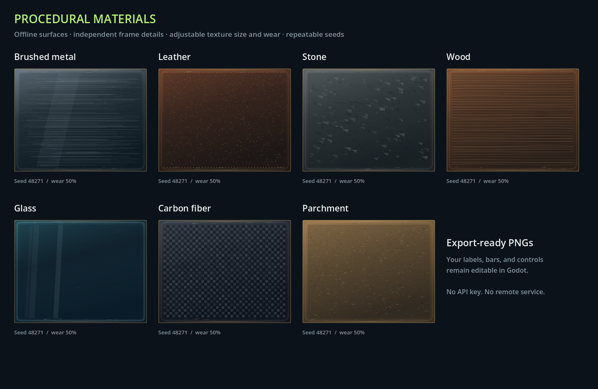

# UI Forge

Create a coordinated fantasy UI kit or a custom gameplay HUD for your Godot
game. Generate menus, buttons, panels, bars, and icons, arrange them in the
preview, then export editable Godot scenes, a theme, and artwork.

## Start here

| What you want to do | Follow this guide |
| --- | --- |
| Run the desktop app on Windows | [Windows: download, extract, launch, and create your first HUD](docs/windows-guide.md) |
| Run UI Forge using the Godot editor | [Godot: open the source project and press Play](docs/godot-guide.md#run-ui-forge-from-source) |
| Create a matching fantasy menu and HUD | [Windows guide: create a fantasy UI kit](docs/windows-guide.md#create-a-fantasy-ui-kit) |
| Generate artwork from a text prompt on your NVIDIA GPU | [Local AI: Windows setup with ComfyUI and SDXL](docs/local-ai-guide.md) |
| Add a generated HUD to your own game | [Godot: import the HUD and connect health to gameplay](docs/godot-guide.md#add-an-exported-hud-to-your-game) |
| Use a complete exported kit in your game | [Godot: add an exported fantasy kit](docs/godot-guide.md#add-an-exported-fantasy-kit-to-your-game) |
| Test the code or build a Windows ZIP yourself | [Development and packaging](docs/development.md) |

## Run on Windows

1. Open [GitHub Releases](https://github.com/Ruslanf89/UI_Generator/releases).
2. Under a release's **Assets**, download `UIForge-windows-x86_64.zip` when available.
3. In Windows File Explorer, right-click the ZIP and choose **Extract All…**.
4. Open the extracted folder, then its `UIForge` folder.
5. Double-click **UIForge.exe**. Keep `UIForge.pck` beside the executable.

The packaged app includes its runtime. You do not need to install Godot, Python,
or Git to run it. It runs locally without an account or API key.

**If there is no Windows ZIP under Assets**, follow the
[Godot source-project instructions](docs/godot-guide.md#run-ui-forge-from-source).
GitHub's **Source code (zip)** and **Code → Download ZIP** downloads contain the
project rather than a ready-to-run Windows executable.

## Create a fantasy UI kit

1. At the top of **Design Brief**, choose **Fantasy UI kit**.
2. Leave **Surprise everything** on, choose a target resolution, and click
   **Generate complete kit**. It rolls the art style, theme, material, map shape,
   resource form, and layout together, using rich decoration.
3. For manual choices, uncheck **Surprise everything**. Choose **Illustrated
   fantasy**, **Medieval pixel**, or **Sculpted fantasy**, a design language,
   material, decoration level, **Map shape**, and **Resource form**.
   These pickers are hidden while surprise is on; a summary shows its result.
   Keep **Keep seed** off to explore fresh designs, or enter a **Design seed**
   to keep and reproduce a starting design. With **Surprise everything** on,
   the kept seed also reproduces the rolled brief.
4. Use the **Menu**, **HUD**, and **Components** cards to explore your matching kit.
   Change the accent color, drag pieces, or resize them with their corner handles.
5. Select a piece in the large preview and click **Regenerate selected** on the
   right to vary its shapes and ornaments. Other pieces and all positions/sizes
   stay intact.
   A piece shared across pages, such as Health, changes across those pages.
   **Ctrl+Z** undoes the regeneration.
6. Click **Export to Godot** and choose an existing destination folder.

The export includes **all three pages**, regardless of the page being previewed:
`menu.tscn`, `hud.tscn`, `components.tscn`, `kit_theme.tres`, generated `art/`
PNGs, `preset.json`, and integration instructions. Buttons include normal,
hover, pressed, disabled, and focus artwork. Labels and bars remain native
editable controls; connect menu actions and sample values to your game code.

The offline generator combines **bundled original vector ornaments** with
seeded drawing and assembly. Griffin, stag, golem, celestial, dragon, wolf,
raven, sun, skull, and kraken motifs coordinate frames, corners, icons, and
resource displays. Larger maps can use circle, hexagon, shield, octagon,
diamond, or square windows; health/mana can use bars, orbs, vials, or segments.
Four menu/HUD compositions also vary panel proportions, spacing, and placement.
All three pages remain part of one matching kit.
Keeping a seed reproduces the initial kit; export to preserve your mouse edits,
individual regenerations, or accepted AI artwork.

Built-in artwork runs locally and needs no separate model or ComfyUI. For
**prompt-generated images**, open **Local AI Art → Open AI studio** on the right
and connect to ComfyUI running on your PC. Choose an installed SDXL checkpoint,
describe the art, and click **Generate AI artwork**. This uses a real local image
model; no provider key or image API fee is required. Follow the
[Windows setup guide](docs/local-ai-guide.md) first. ComfyUI and model downloads
are separate from UI Forge.

The full AI batch is applied after it succeeds. You can then regenerate a
selected component, undo accepted changes, or choose **Use procedural art**.
Positions, sizes, native text, and bars remain editable. AI images may need
prompt retries and edge review; their colors come from the prompt.

Built-in Medieval pixel artwork uses a coarse pixel grid and nearest filtering;
whole-number game viewport scaling keeps it sharpest. A model's interpretation
of a pixel-art prompt may vary.

## Create and export your first HUD

1. Click **New UI** and keep **HUD layouts** selected. Choose a game type, such as **FPS**.
2. Choose a visual style, such as **Military**.
3. Tick the components you want. Scroll the component list to see all options.
4. Choose a target resolution and click **Generate 3 variations**.
5. Click a variation's thumbnail or name. Change the accent color and HUD size
   on the right. Health and mana sliders preview the selected bars.
6. Drag components in the large preview to arrange them, then drag a selected
   component's corner handles to rescale it. Optional snapping, keyboard
   nudging, undo/redo, and **Reset this layout** help refine placement.
7. In **Offline Material Art** on the right, choose a material and frame detail,
   then click **Generate art**. Adjust texture size, wear, and opacity; **New**
   beside the seed generates another surface. Scroll the right panel if needed.
8. Click **Export to Godot** and select an existing folder to save into.

The app creates a new folder containing `hud.tscn`, `hud_theme.tres`,
`preset.json`, and a `README.md` integration guide. Copy the **whole folder** into
your game's Godot project, then follow the
[step-by-step Godot import guide](docs/godot-guide.md#add-an-exported-hud-to-your-game).
When artwork is enabled, the folder also includes generated PNGs under `art/`.
The exported scene keeps your custom element positions and individual scales.

## What this version provides

- A complete fantasy kit in three art styles, with matching Menu, HUD,
  and Components pages and regeneration of individual pieces.
- Ten design languages with bundled original vector motifs, seeded assembly,
  and four menu/HUD compositions with different grouping and placement.
- **Surprise everything** for a fresh complete brief, or manual choices with a
  repeatable seed; six map-window shapes and four health/mana forms.
- Three kit materials and three decoration levels, with procedural icons,
  button states, framed panels, health/mana bars, and inventory/ability samples.
- Optional local ComfyUI/SDXL prompt-to-art generation for fantasy kits, with
  whole-kit generation, individual regeneration, and portable PNG exports.
- Six game types: FPS, RPG, RTS, Racing, Survival, and Platformer.
- Six styles: Military, Fantasy, Modern, Horror, Sci-fi, and Minimal.
- Twelve optional HUD components and three coordinated layout variations.
- Mouse placement and proportional corner resizing per variation, optional
  8 px snapping, arrow-key nudging,
  undo/redo, and preset layout reset.
- Seven offline materials: brushed metal, leather, stone, wood, glass, carbon
  fiber, and parchment. Combine them with ornate, tech, weathered, or clean frames.
- Adjustable texture size, wear, opacity, and repeatable seeds; portable PNG exports.
- Editable native Godot controls and a shared theme, with no generator plugin
  required in your game.

Generation uses local templates. Menus, maps, ammo, timers, inventory, and ability
slots use example data; connect them to your game logic. The preview background
is not included in exports. Built-in artwork combines original bundled vector
parts with procedural drawing on your PC;
optional AI artwork runs through a separately installed local ComfyUI model.
Neither route requires a provider key. Exported games need only their generated
scenes, theme, and images.

Designs are held in memory. **Export before closing the app, generating a new
design, or clicking New UI.**
Changing the brief requires Generate to apply; Generate resets the current
color, size, sample values, component positions/scales, and generated artwork.
Kit generation creates a fresh coordinated seed unless **Keep seed** is on;
full generation resets custom edits in either case. Use **Regenerate selected**
to refine one piece of an existing kit.
Existing exports are kept in separate folders. Loading exported presets back
into the designer is not implemented.

The app and exports target **Godot 4.6+**, tested with **4.6.3**. The packaged
desktop targets Windows x64 with OpenGL 3.3-compatible graphics and needs space
for a **1120 × 900** window. Packaging and application checks ran on Linux;
native Windows execution remains untested.
