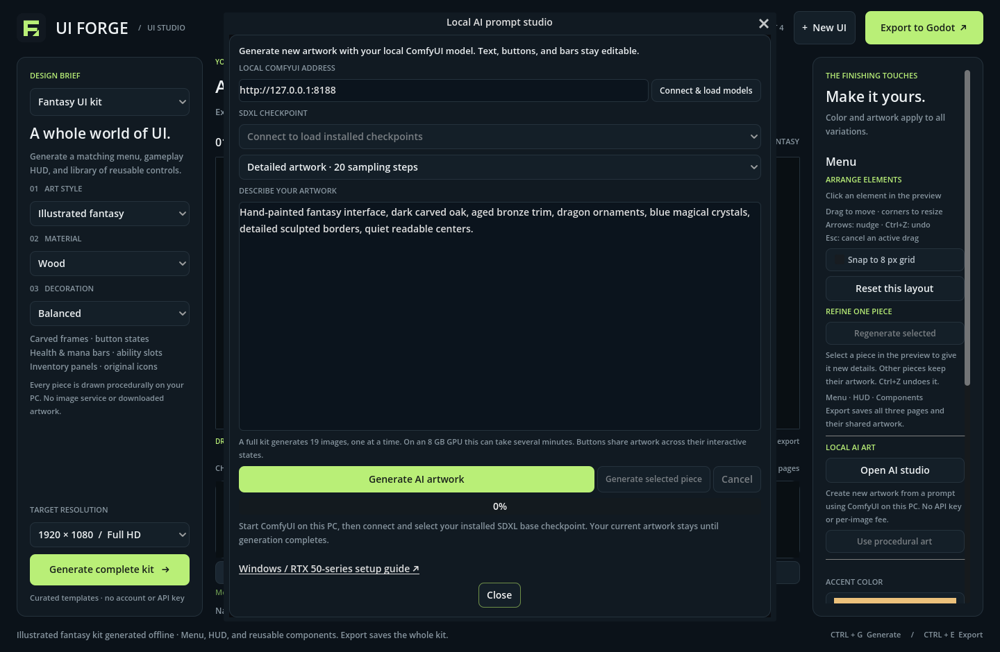

# Local AI artwork on Windows

UI Forge can send your description to **ComfyUI running on your own PC** and
use the generated pictures in a fantasy UI kit. This guide uses **Stable
Diffusion XL (SDXL) Base 1.0** with an **NVIDIA RTX 5060 8 GB**. There is no image
API fee or provider key. Your PC supplies the computing power and storage.

You install ComfyUI and the model once. After those downloads, generation can
run locally without an internet connection. UI Forge does not install or start
ComfyUI for you. Keep ComfyUI running while generating artwork; exported Godot
scenes work independently afterward.

[Back to the Windows guide](windows-guide.md) · [Godot integration](godot-guide.md#add-an-exported-fantasy-kit-to-your-game)

## 1. Prepare your NVIDIA driver

1. Save your work and close games or other programs using the GPU.
2. Open the [official NVIDIA driver page](https://www.nvidia.com/Download/index.aspx)
   or NVIDIA App and install the current driver for your RTX 5060 and Windows
   version. Restart Windows if the installer requests it.
3. Have enough disk space for ComfyUI, its embedded runtime, a roughly 7 GB
   checkpoint, and generated images. Allow additional free space while extracting
   the downloads.

RTX 50-series cards use NVIDIA's Blackwell architecture. Use the **current
standard NVIDIA portable package** below. Older CUDA/PyTorch packages can fail
with messages such as **no kernel image is available for execution on the
device** or an unsupported CUDA capability. Installing a separate CUDA Toolkit
is unnecessary for the portable route: its runtime is included.

## 2. Install the official ComfyUI Windows Portable package

1. Open [ComfyUI's official latest NVIDIA portable download](https://github.com/Comfy-Org/ComfyUI/releases/latest/download/ComfyUI_windows_portable_nvidia.7z).
   You can also find **ComfyUI_windows_portable_nvidia.7z** on the
   [official releases page](https://github.com/Comfy-Org/ComfyUI/releases).
2. Use the standard NVIDIA archive, with that exact filename. The current
   official package uses Python 3.13 and PyTorch with CUDA 13.0. The separate
   **nvidia_cu126** archive is intended for older GPUs; do not choose it for
   the RTX 5060. Package versions change, so follow the current
   [official portable instructions](https://docs.comfy.org/installation/comfyui_portable_windows)
   if the filenames or supported versions change.
3. Install [7-Zip](https://7-zip.org/) if Windows cannot extract `.7z` files.
4. In File Explorer, right-click the downloaded archive and use **7-Zip →
   Extract files…**. Choose a simple writable location, for example
   `C:\AI`. Use **Show more options** if the 7-Zip menu is hidden.
5. Open the extracted **ComfyUI_windows_portable** folder. Keep its folders
   together. You should see:

```text
C:\AI\ComfyUI_windows_portable\
  ComfyUI\
    models\
      checkpoints\
  python_embeded\
  run_nvidia_gpu.bat
  run_cpu.bat
```

This package has its own Python environment. You do not need to install Python,
run `pip`, or add custom nodes for UI Forge's supported workflow.

## 3. Add the SDXL checkpoint

1. Open Stability AI's official
   [SDXL Base 1.0 model page](https://huggingface.co/stabilityai/stable-diffusion-xl-base-1.0).
2. Open **Files and versions** and download **sd_xl_base_1.0.safetensors**.
   This is the full checkpoint file, approximately 7 GB. Follow the publisher's
   download/sign-in instructions if shown, and read its model license.
3. Move that file into:

```text
C:\AI\ComfyUI_windows_portable\ComfyUI\models\checkpoints\sd_xl_base_1.0.safetensors
```

4. Keep the `.safetensors` filename extension. A ZIP, a web page saved as a file,
   or an incomplete browser download will not load as a checkpoint.

Use **SDXL Base 1.0** for your first test. This integration uses ComfyUI's
standard full-checkpoint workflow with CLIP encoding, sampling, VAE decoding,
and image saving. Refiner-only files, LoRAs, separate diffusion weights, FLUX,
and other model families are not substitutes for this checkpoint. UI Forge
lists installed checkpoints, but cannot guarantee that every listed model is
compatible. The model and runtime are downloaded separately from UI Forge.

## 4. Start ComfyUI and generate one test image

1. Double-click **run_nvidia_gpu.bat** in the portable folder.
2. Keep the command window open. Wait until it prints an address such as:

```text
To see the GUI go to: http://127.0.0.1:8188
```

3. If a browser does not open, visit **http://127.0.0.1:8188** yourself.
   This address points to your own PC. Leave ComfyUI using its default local
   address; UI Forge connects to this local server.
4. In ComfyUI, open the default/basic text-to-image workflow. **Ctrl+D** loads
   the default workflow in versions providing that shortcut. You need the
   built-in **Load Checkpoint**, **CLIP Text Encode**, **Empty Latent Image**,
   **KSampler**, **VAE Decode**, and **Save Image** nodes.
5. In **Load Checkpoint**, select **sd_xl_base_1.0.safetensors**. Refresh the
   browser or restart ComfyUI if you added the checkpoint after starting it.
6. In **Empty Latent Image**, set **width = 768**, **height = 768**, and
   **batch_size = 1**. Start small to verify your 8 GB setup. SDXL normally
   works best near a 1024-pixel image size; this first test favors lower memory
   use over final detail.
7. Enter a simple positive prompt, for example:

```text
A single carved oak fantasy game button, gold metal trim, green gemstone,
front view, centered, isolated on a solid bright magenta background, no text
```

8. Use about **12–20 steps** for this test, then click **Run/Queue Prompt** or
   press **Ctrl+Enter**. The first image also loads the model and can take longer.
9. Confirm that an image appears and the command window reports your NVIDIA
   GPU without CUDA or out-of-memory errors.

Resolve errors in this browser test before connecting UI Forge. This separates
model/driver setup from the app connection. See ComfyUI's
[first-generation guide](https://docs.comfy.org/get_started/first_generation)
and [SDXL examples](https://comfyanonymous.github.io/ComfyUI_examples/sdxl/)
if you need help with its workflow screen. SDXL Base can run without a refiner.

## 5. Generate AI artwork in UI Forge

1. Leave ComfyUI running and open UI Forge.
2. At the top of **Design Brief**, select **Fantasy UI kit**. Leave **Surprise
   everything** on to roll a brief, or uncheck it to choose the art style,
   design language, material, decoration, map shape, and resource form. Click
   **Generate complete kit**.
   This creates the editable Menu/HUD/Components layout. **Keep seed** can
   reproduce the initial procedural layout; full generation resets later edits
   and accepted AI images, so export the result you want to keep first.
3. Scroll the right-hand inspector to **Local AI Art** and click
   **Open AI studio**. The **Local AI prompt studio** dialog opens.
4. Leave the server address at **http://127.0.0.1:8188** and click
   **Connect & load models**.
5. Choose **sd_xl_base_1.0.safetensors** from the model list.
6. Enter the artwork you want in the prompt box. Describe materials, colors,
   shapes, trim, and the overall visual treatment. For example:

```text
Hand-painted fantasy game UI, dark carved oak and aged gold trim,
emerald gemstones, curved wooden edges, subtle leaf ornaments,
readable open centers, warm highlights, cohesive front-facing shapes
```

7. Choose **Detailed artwork · 20 sampling steps**, or **Fast preview · 12 sampling
   steps** for quicker experiments. Click **Generate AI artwork** and read the
   status line for progress. UI Forge
   sends your prompt to the local model for the kit's different art roles;
   the words do not select a collection of procedural keyword presets.
8. Wait for the complete result. A full kit generates **19 source images**
   sequentially at batch size 1, using the selected sampling quality and image
   sizes between 512 and 1024 pixels. It can take several minutes. Duration
   depends on your GPU, free VRAM, system memory, and model load time.
9. Compare **Menu**, **HUD**, and **Components**. Review icons, frame centers,
   text readability, and edges before exporting.

For a quicker first experiment, select a button or panel in the large preview
before opening the studio, then click **Generate selected piece**. This creates
AI artwork for that piece while the rest of the kit keeps its existing artwork.
You can refine your prompt on one piece before generating all 19 images.



The current kit stays visible until the full requested batch succeeds. A failed
or cancelled batch keeps the previously accepted artwork and arrangement.
**Cancel** stops UI Forge waiting and submitting further images; an image already
running in ComfyUI may still finish. Other ComfyUI jobs are not interrupted.

UI Forge uses the model to create pictures. Layouts, button text, Labels, and
resource displays remain editable Godot controls. SDXL does not connect menu actions
or game statistics to gameplay. The app asks for artwork without lettering so
that real editable text can be placed above it.

### Refine an accepted AI kit

1. Select a component in the large preview.
2. Click **Regenerate selected** to ask the model for fresh artwork for that
   component's required art roles. Keep ComfyUI running.
3. Other components and all positions/sizes remain intact. **Ctrl+Z** restores
   the previously accepted images; redo reuses the accepted result without
   making another model request.
4. Use **Use procedural art** in the inspector to return to the kit's built-in
   generated artwork. This change can also be undone.

The prompt controls the colors of AI images. The accent picker is disabled
while AI artwork is active. Describe a different palette and
generate again to change them. To apply a new kit art style, design language,
material, decoration, map shape, or resource form, export the current result
first, generate the new kit, and then
request its AI artwork.

UI Forge remembers the local address, model choice, and prompt on your PC for
the next session. This does not save or reopen the generated kit; export the
result you want to keep.

## 6. Review edges and export

The integration asks for a flat magenta background and removes the matte
automatically. SDXL can still draw shadows, unwanted letters, extra objects,
or magenta details inside the artwork. Background removal and matching between
separately generated pieces can need a prompt adjustment and another attempt.
Avoid asking for magenta-colored artwork because it can be removed with the
background. This first workflow does not guarantee transparent production art
or the finish of a manually illustrated commercial UI pack.

When you like the result, use **Export to Godot**. Copy the entire export folder,
including its `art/` PNGs, into your game as described in the
[Godot guide](godot-guide.md#add-an-exported-fantasy-kit-to-your-game).
The exported scenes and images need **neither ComfyUI nor the model** in your
game. Export before closing UI Forge, clicking **New UI**, or generating a new
complete kit. Exported presets cannot yet be reopened in the designer.

## Troubleshooting an RTX 5060 8 GB setup

| Symptom | What to do |
| --- | --- |
| No kernel image / unsupported CUDA capability | Install the current NVIDIA driver and extract the latest standard NVIDIA portable package. Avoid an old portable runtime or the `cu126` package. Test in ComfyUI before UI Forge. |
| Torch not compiled with CUDA / no NVIDIA GPU | Use `run_nvidia_gpu.bat` from the NVIDIA portable package. Check the driver and the error in its command window. |
| ComfyUI address will not open | Keep its command window open and wait for the server address. Start it again if it closed; read the error before retrying. |
| UI Forge cannot connect | Check that the browser opens `http://127.0.0.1:8188`. Use the same local HTTP address and port in UI Forge. Only local addresses are supported. |
| Connected but no models | Place the complete SDXL checkpoint in `ComfyUI/models/checkpoints`, restart ComfyUI, then click **Connect & load models** again. |
| Checkpoint/workflow error | Choose SDXL Base 1.0. Refiner-only files and unrelated model families do not work with this workflow. |
| CUDA out of memory | Close games and other GPU-heavy apps. Keep batch size 1, use lower image sizes in your manual ComfyUI test, and try the memory fallback below. UI Forge already submits one image at a time. |
| Generation appears stalled | Check ComfyUI's command window and queue. The first model load and any earlier queued job add waiting time. |
| Magenta fringes, holes, or unwanted lettering | Adjust the prompt, avoid magenta-colored subject details, and regenerate. Review the result before exporting. |

### Optional memory fallback

Try ComfyUI's automatic memory management first. If it still runs out of memory,
close its command window and create a separate fallback launcher:

1. In File Explorer, enable **View → Show → File name extensions**.
2. In the portable folder, create **run_uiforge_lowvram.bat** with Notepad.
   When saving, select **All files** so it does not become `.bat.txt`.
3. Save these two lines:

```bat
.\python_embeded\python.exe -s ComfyUI\main.py --windows-standalone-build --disable-dynamic-vram --lowvram --cpu-vae
pause
```

4. Double-click the new file and repeat the single-image browser test.

This trades speed for lower GPU memory pressure and uses system RAM/CPU for
parts of the job. In current ComfyUI, `--lowvram` has no effect while dynamic
VRAM is enabled, so the fallback explicitly disables that mode. `--cpu-vae`
moves image decoding to the CPU. Keep the original launcher so you can return
to the default behavior. These flags do not fix an incompatible CUDA runtime.

## Official setup references

- [ComfyUI README: Windows Portable](https://github.com/Comfy-Org/ComfyUI#windows-portable)
- [ComfyUI Portable for Windows](https://docs.comfy.org/installation/comfyui_portable_windows)
- [ComfyUI startup flags](https://docs.comfy.org/development/comfyui-server/startup-flags)
- [Stability AI SDXL Base 1.0](https://huggingface.co/stabilityai/stable-diffusion-xl-base-1.0)
- [SDXL model release and license](https://github.com/Stability-AI/generative-models#july-26-2023)

The driver/runtime guidance follows the current official portable documentation.
The UI Forge development checks use a simulated local ComfyUI server; actual
inference speed, image quality, and RTX 5060 behavior must be checked on your PC.
