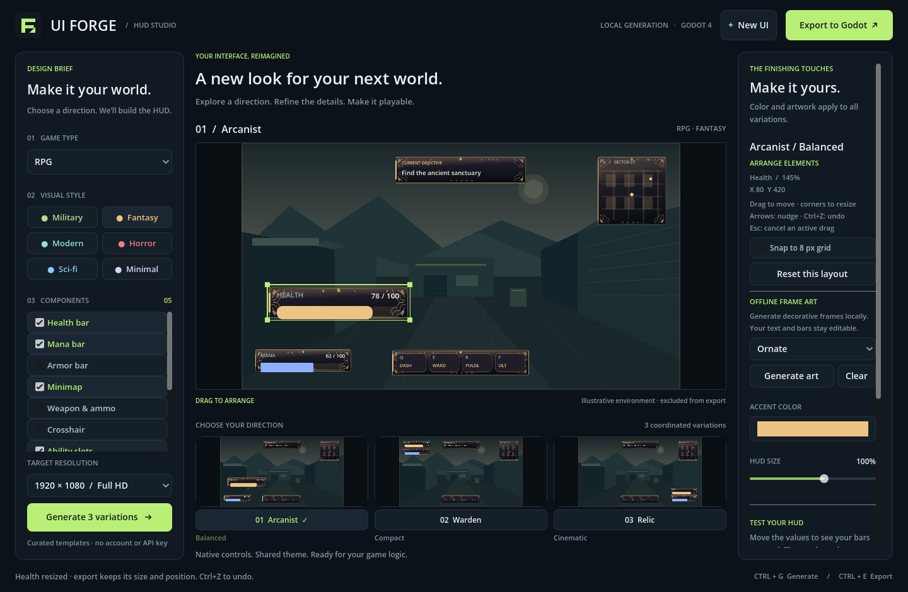

# Windows user guide

This guide takes you from downloading UI Forge to exporting your first HUD.
You do not need programming knowledge to design and export a HUD. Connecting
that HUD to a running game is covered in the [Godot guide](godot-guide.md).

[Back to the project home page](../README.md)

## 1. Choose the right download

| Download | What you receive | How you open it |
| --- | --- | --- |
| `UIForge-windows-x86_64.zip` in a release's **Assets** | The packaged desktop app | Extract it, then double-click `UIForge.exe` |
| **Code → Download ZIP** or **Source code (zip)** | The Godot source project | Import `project.godot` into Godot, then press F5 |

For the packaged app, open
[UI Forge Releases](https://github.com/Ruslanf89/UI_Generator/releases).
Choose a release that includes `UIForge-windows-x86_64.zip` under **Assets**.
Prereleases are development previews. If no Windows ZIP is listed, follow
[Run UI Forge from source](godot-guide.md#run-ui-forge-from-source).

The packaged app targets **Windows x64** and requires **OpenGL 3.3-compatible
graphics**. Its smallest window is **1120 × 900**. The runtime is included;
installing Godot, Python, Git, or export templates is unnecessary for this route.
Internet access is needed for downloading, but generation runs locally.

## 2. Extract the app

1. Wait for `UIForge-windows-x86_64.zip` to finish downloading.
2. Open **File Explorer → Downloads** and locate that ZIP.
3. Right-click it and choose **Extract All…**.
4. Choose a writable destination, for example
   `C:\Users\YourName\Documents\UIForgeApp`, and click **Extract**.
   Replace `YourName` with your Windows account name.
5. Open the extracted folder and then the **UIForge** folder inside it.

You should see these files, along with the documentation and license notices:

```text
UIForge/
  UIForge.exe
  UIForge.pck
  README.txt
  docs/
    windows-guide.md
    godot-guide.md
    examples/
      health_demo.gd
```

Run the app from the **extracted folder**. Opening the executable while browsing
inside the ZIP may leave its companion files unavailable.

## 3. Open the app

1. Double-click **UIForge.exe**.
2. Leave **UIForge.pck** in the same folder. It contains the app's scenes,
   scripts, and visual resources.
3. Wait for the **UI FORGE** window. It opens with an FPS/Military design and
   three variations already generated.

There is no installer or sign-in screen. To create a desktop shortcut,
right-click `UIForge.exe` and use **Show more options → Send to → Desktop
(create shortcut)**. The shortcut should point to the executable in its
extracted folder. Keep the whole app folder together when moving it.

## 4. Understand the window



| Area | What it controls |
| --- | --- |
| **Design Brief**, on the left | Game type, visual style, components, target resolution, and Generate |
| Large central preview | The selected HUD variation over an illustrative background |
| Three thumbnails below the preview | Balanced, Compact, and Cinematic layout options |
| **The Finishing Touches**, on the right | Accent color, HUD size, and example health/mana values |
| **Arrange Elements**, in the right panel | Selected component coordinates, grid snapping, and layout reset |
| **Offline Frame Art**, in the right panel | Procedural artwork detail and Generate art / Clear buttons |
| **New UI**, at the top | Resets the brief and customizations to the initial FPS/Military design |
| **Export to Godot**, at the top | Saves the selected design into a new folder |
| Status line, at the bottom | Generation messages, export location, and errors |

## 5. Create a first FPS HUD

1. Click **New UI** to start with the default design. Export any design you
   want to keep before resetting it.
2. Under **01 Game Type**, select **FPS**.
3. Under **02 Visual Style**, click **Military**.
4. Under **03 Components**, keep Health bar, Armor bar, Minimap, Weapon & ammo,
   Crosshair, and Objective tracker selected. Scroll inside this list to find
   the lower options. Untick components you do not want.
5. Leave **Target Resolution** at **1920 × 1080 / Full HD**.
6. Click **Generate 3 variations**.
7. Click **01 Vanguard**, **02 Recon**, or **03 Sentinel** below the thumbnails
   to compare the layouts. Clicking a thumbnail also selects that variation.
8. Choose the variation you prefer. The large preview shows the design that
   will be exported.

Other genres select different starting components. For example, choose **RPG**
to start with health, mana, minimap, abilities, and objectives. Component choices
remain editable for every genre. At least one component must be selected.

## 6. Customize the selected design

1. Click the color swatch under **Accent Color** and choose a color.
2. Move **HUD Size** to change component sizes between 85% and 110%.
3. If Health bar is included, move the **Health** slider to see it change.
4. If Mana bar is included, move the **Mana** slider to see it change.
   A faded slider means that component is not in the generated HUD.

Accent, size, health, and mana changes appear immediately and carry into the
export. They apply to all three generated variations.

### Move components with your mouse

1. Click a component in the **large central preview**, such as the health bar.
   A green outline shows the selection; its design-canvas X/Y coordinates appear
   under **Arrange Elements** on the right.
2. Hold the left mouse button, drag the component, and release to keep its position.
   The component stays inside the 1280 × 720 design canvas.
3. Enable **Snap to 8 px grid** for aligned mouse placement.
4. After selecting a component, use the **arrow keys** to move it 1 design pixel,
   or **Shift+arrow** for 10 pixels.
5. Use **Ctrl+Z** to undo a position edit; **Ctrl+Shift+Z** or **Ctrl+Y** redoes it.
6. Click **Reset this layout** to return the current variation's components to
   their preset positions and sizes. This reset can also be undone.

### Rescale a component with your mouse

1. Click a component in the large preview to select it.
2. Hover over one of its four green corner handles. The cursor changes to a
   diagonal resize arrow.
3. Hold the left mouse button and drag the corner outward to enlarge the
   component, or inward to shrink it.
4. Release to keep the size. Text, bars, icons, and artwork scale together,
   preserving the component's proportions. The opposite corner stays fixed.
5. Read the selected component's percentage under **Arrange Elements**.
6. Press **Ctrl+Z** to undo the resize, or **Ctrl+Shift+Z** / **Ctrl+Y** to redo.
   Press **Esc** during a move or resize to cancel that unfinished gesture.

Individual scales range from 35% to 300% of the preset size. Canvas edges may
limit enlargement; move the component away from an edge for more room. With
**Snap to 8 px grid**, resizing snaps the width while preserving proportions.
The **HUD Size** slider scales the overall design on top of individual scales.

Positions are stored separately for Balanced, Compact, and Cinematic. Switching
variations keeps their edits. Changing color or frame artwork keeps custom
positions and scales; the exported scene uses the same arrangement. Thumbnails
select variations; dragging is enabled in the large preview.

### Generate decorative artwork offline

1. Scroll the right-hand panel to **Offline Frame Art**.
2. Choose **Style native**, **Ornate**, **Tech**, or **Weathered**.
   Style native chooses details for the current visual style: for example,
   filigree for Fantasy or technical borders for Sci-fi.
3. Click **Generate art**. Frames appear behind the text and progress bars in
   all three variations. Each click creates a new random seed.
4. Change the accent color to recolor the frames while keeping the same seed.
5. Click **Clear** to remove artwork and keep your custom positions.

Artwork is generated procedurally on your PC, without an AI service, account,
or API key. It decorates panel components; the crosshair keeps its native shapes.
Labels and bars stay editable, and exports include separate PNG files for the
frames. Layout undo/redo applies to moving and resizing, not artwork changes.

Changing game type, style, components, or resolution leaves a **Changes pending**
message. Click **Generate** to apply those changes. Generate resets accent,
size, sample values, component positions/scales, and artwork to defaults, so
refine those settings after generation. Export always uses the visible design.

Keyboard shortcuts: **Ctrl+G** generates; **Ctrl+E** opens export.

## 7. Export your HUD

1. In File Explorer, create a folder such as
   `C:\Users\YourName\Documents\UIForgeExports`.
2. In UI Forge, select the variation you want to use.
3. Click **Export to Godot**.
4. In the folder chooser, navigate to `Documents\UIForgeExports` and select
   that folder as the destination. The destination must already exist.
5. Wait for the **Your HUD is ready** message. It shows the full output path.
6. Open that path in File Explorer.

For the FPS/Military/Balanced example, the app creates a folder like this:

```text
UIForgeExports/
  uiforge_fps_military_balanced/
    hud.tscn
    hud_theme.tres
    preset.json
    README.md
    art/                         # present when frame artwork was generated
      health.png
      ...other panel frames...
```

Repeated exports create new folders with suffixes such as `_2`; they do not
overwrite previous exports.

| Exported file | How you use it |
| --- | --- |
| `hud.tscn` | The HUD scene you add to your game in Godot |
| `hud_theme.tres` | Shared styling; keep it beside `hud.tscn` |
| `preset.json` | A record of your design choices and sample values |
| `README.md` | Instructions included with this particular HUD |
| `art/` (optional) | Generated PNG frames referenced by the scene; copy this folder too |

Continue with [Add an exported HUD to your game](godot-guide.md#add-an-exported-hud-to-your-game).

## 8. Keep your work

Export before closing the app or clicking **New UI**. Designs are currently
held in memory, and reopening exported presets in UI Forge is not implemented.
You can keep editing the exported scene and theme directly in Godot.

The minimap, weapon values, timers, and ability slots contain example data.
They become functional when connected to your game's code. The central preview
background is illustrative and is not exported. Generation uses local templates.

## Troubleshooting

| What you see | What to do |
| --- | --- |
| No `UIForge.exe` in the download | You may have downloaded the source ZIP. Follow the Godot source-project guide, or choose the Windows app ZIP under a release's Assets. |
| Godot Project Manager appears instead of UI Forge | Extract the complete app ZIP again and keep the matching `UIForge.exe` and `UIForge.pck` together. |
| A missing resource/pack error, or the app closes immediately | Run from the extracted folder, confirm the PCK exists, and extract a fresh complete copy if a file is missing. |
| A graphics/OpenGL error | Check that the PC supports OpenGL 3.3 and install the graphics driver supplied by the GPU or PC manufacturer. |
| Bottom controls are off screen | Maximize the app. Windows display resolution and scaling must leave enough room for the 1120 × 900 minimum window. Check **Settings → System → Display**. |
| Mana or health slider is faded | Select that component on the left and click Generate. |
| Changing style does not change the preview | Click Generate to apply the pending brief. |
| Dragging a thumbnail does not move a component | Choose a variation, then drag its component in the large central preview. |
| Artwork or arrangement controls are missing | Scroll inside the right-hand inspector panel. |
| Art generation says it needs a panel | Include Health, Minimap, Weapon, or another panel component. The crosshair is made of native shapes. |
| Export fails | Choose an existing writable folder, such as a folder in Documents. Read the status line for the specific error. |
| Map or ammo is not changing in a game | Those are sample controls; follow the Godot integration guide and connect gameplay data. |

To report a problem, open a
[GitHub issue](https://github.com/Ruslanf89/UI_Generator/issues) with your Windows
version, app version or download filename, exact error text, and steps that
caused it. Packaging was checked on Linux; native Windows launch has not yet
been validated in this project.
